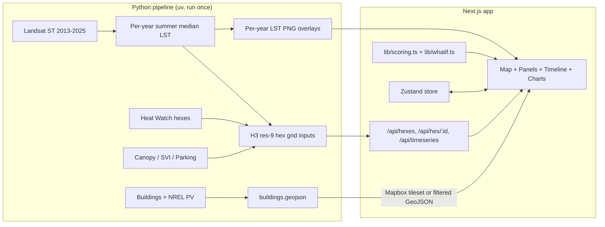

# Implementation Plan: Boston Urban Heat Island Dashboard ("CoolBoston", placeholder name)

## Problem Statement
Boston planners and advocates need to see where urban heat is concentrated and which fix (green roofs, cool roofs, solar, trees, cool pavement) fits each place. This is a 9-hour solo hackathon build: a 3D map dashboard styled like the FireTrace screenshot (map in the center, layers/metrics panel on the right, timeline and time-series charts along the bottom).

## Requirements
- 3D Mapbox map of Boston with extruded buildings, a heat layer, and context layers.
- Right panel with layer toggles and opacity, intervention selection, metrics, and a methodology tab.
- Bottom timeline covering 2013–2025, one summer surface temperature map per year from Landsat, with play and scrub controls. Time-series charts below it.
- Each hexagon scored 0–100 for each intervention using a simple, documented weighted formula.
- Per-building scores (green roof, cool roof, solar) shown by coloring the 3D buildings.
- What-if simulator: adopt intervention X on the top N% of sites and see the estimated temperature drop on the map and in the metrics.
- Stack: Next.js (App Router, TypeScript), Mapbox GL JS v3, deck.gl, Tailwind + shadcn/ui, Recharts, Zustand. Python preprocessing runs offline; Next.js route handlers serve the results.
- Solo developer, comfortable in Python and React.

## Background (research findings)

### Heat data
- Landsat Collection 2 Level-2 surface temperature (band ST_B10, via Planetary Computer STAC). Kelvin = DN × 0.00341802 + 149.0. Landsat 8 starts 2013, Landsat 9 starts 2021.
- Heat Watch / Wicked Hot Boston 2019 hexes (air temperature and heat index at 6am, 3pm, 7pm) on Analyze Boston / MassGIS ("Canopy Change Assessment: Heat Metrics"). Raw data on OSF (osf.io/49rjw). Used for the base layer and to validate against real air temperature.

### Context data
- Canopy Change Assessment and Urban Forest Plan priority zones (Analyze Boston).
- CDC Social Vulnerability Index (census tracts).
- Boston Buildings with Roof Breaks (roof outlines and heights from lidar). MassGIS Building Structures (2-D) as a fallback.
- NREL PV Rooftop Database (solar potential). Google Project Sunroof for summary stats as a fallback.
- BERDO (large-building energy use). Optional, not in core scope.
- OpenStreetMap parking lots (`amenity=parking`) and MassGIS impervious surface.
- Logan Airport hourly weather (Iowa Environmental Mesonet ASOS). Optional.

### Cooling effect references
- EPA Heat Island Compendium (green roof surfaces up to 56°F cooler than conventional roofs; air temperature reductions of up to 20°F cited for green roofs).
- Smith et al. 2025 (BU), "Integrated tree canopy expansion and cool roofs can optimize air temperature and heat exposure reductions in Boston". Tree canopy expansion has a 35% larger air temperature effect than cool roofs; cool roofs give larger exposure reductions because of where they can be installed.
- These figures are rough estimates. The UI must label every estimate as approximate.

### Mapbox notes and risks
- Free tier is 50k map loads per month. A load counts when a Map object is created, so remounts count. Keep the map mounted in the root layout and avoid re-creating it.
- The access token ships in the browser. Restrict it by URL in the Mapbox account settings.
- Mapbox GL JS v2+ is proprietary. The attribution must stay visible.
- Use a classic style (Dark / Satellite Streets), not Standard, so buildings can be colored by data.
- Use deck.gl interleaved mode so overlays layer correctly with 3D buildings. Test this early.
- The map must be client-only (`dynamic(..., { ssr: false })`).
- Boston is flat, so the 3D effect comes from extruded buildings and camera pitch, not terrain.
- Landsat thermal data is natively 100 m (resampled to 30 m), so it looks blocky at street zoom. Use it at neighborhood zoom.
- Send the browser hexes and filtered buildings, not raw points.
- Conference wifi risk: record a backup demo video.

## Proposed Solution



### Architecture decisions
- **Backend:** no separate server. Offline Python scripts write JSON/GeoJSON into `web/data/`; Next.js route handlers (`app/api/*`) serve them. One app, deployable to Vercel.
- **Grid:** H3 resolution 9 (about 0.1 km² cells, roughly 1–2k cells covering Boston). Python writes the raw inputs per hex (LST per year, canopy %, SVI, flat-roof area, roof area, PV potential, parking share).
- **Scoring in TypeScript:** the scoring formulas and weights live in `lib/scoring.ts`, a single source of truth for the map, the methodology tab, and the what-if simulator. The building-level scoring in Python must match it (parity test with shared fixtures).
- **Score formula** (every input converted to percentile rank, 0–1; score = 100 × weighted sum):
  - Green roof = 0.40·heat + 0.25·vulnerability + 0.35·flat-roof area
  - Cool roof = 0.45·heat + 0.25·vulnerability + 0.30·roof area
  - Solar = 0.30·heat + 0.20·vulnerability + 0.50·PV potential
  - Trees = 0.40·heat + 0.30·vulnerability + 0.30·(1 − canopy)
  - Cool pavement = 0.45·heat + 0.20·vulnerability + 0.35·parking share
- **What-if:** estimated temperature change per hex = Σ (coefficient × added coverage fraction). Coefficients live in `lib/coefficients.ts` with citations. Runs entirely in the browser.
- **Buildings:** filter to roofs larger than about 2,000 sq ft. Upload as a Mapbox tileset and color extrusions with data-driven expressions. Fallback: simplified GeoJSON under 15 MB with trimmed coordinates.
- **Security:** read-only public data, no authentication. API routes still validate inputs (hex ID format, year range).

### Repo layout
```
hackachusetts/
  PLAN.md
  web/        # Next.js app (TypeScript, Tailwind, shadcn/ui, Zustand, Recharts, deck.gl, react-map-gl)
  pipeline/   # Python (uv, geopandas, h3, pystac-client, planetary-computer, rioxarray, osmnx, pytest)
  .env.example  # NEXT_PUBLIC_MAPBOX_TOKEN
```

## Task Breakdown
Estimated total about 8.5 hours. If time runs short, cut Task 8 first, then Task 7.

### Task 0: Repo setup (10m)
- Objective: `git init`, create `web/` and `pipeline/`, `.gitignore`, `.env.example`.
- Demo: Repo exists with PLAN.md in place.

### Task 1: Next.js shell with a 3D Boston map (45m)
- Objective: A dashboard layout shaped like FireTrace (top bar, map, right panel, bottom timeline area) with a working 3D Mapbox map.
- Guidance: `create-next-app` with TypeScript, Tailwind, App Router; add shadcn/ui, Zustand, Vitest. `MapView` is a client component loaded with `dynamic(..., { ssr: false })`. Classic dark or satellite style with a `fill-extrusion` building layer, pitch about 60, centered on Boston. Keep the map mounted in the root layout. Placeholder panels.
- Tests: Vitest setup with a store test (default year, default intervention).
- Demo: Boston in 3D inside the dashboard frame; pan, tilt and rotate work.

### Task 2: Pipeline foundation, hex grid, and Heat Watch heat layer (1h)
- Objective: Generate the hex grid with Heat Watch 3pm temperature and display it on the map.
- Guidance: `pipeline/` with uv, geopandas, h3, pytest. Boston boundary → H3 res-9 cells → area-weighted join of Heat Watch hexes → `web/data/hexes.json`. Route `GET /api/hexes`. deck.gl `H3HexagonLayer` (interleaved mode) with a temperature color ramp and hover tooltip.
- Tests: pytest for grid coverage and join correctness on a small fixture; Vitest for the color-ramp function.
- Demo: Heat hexagons over the 3D city, temperature on hover.

### Task 3: Landsat yearly surface temperature and the timeline (1.5h, highest risk)
- Objective: One summer surface temperature value per hex per year (2013–2025) plus a raster overlay per year, driven by the timeline.
- Guidance: pystac-client, planetary-computer, rioxarray. Search June–August scenes with under 20% cloud cover, mask clouds using QA_PIXEL, take the median composite per year clipped to Boston. Write per-hex yearly averages into `hexes.json` and save a colorized PNG plus geographic bounds per year. Frontend: timeline component (play, pause, scrub, speed) bound to `year` in the store; a deck.gl `BitmapLayer` swaps the PNG for the selected year and hexes recolor. Fallback if Landsat takes too long: every other year.
- Tests: pytest for DN→°C conversion and cloud masking on a synthetic array; Vitest for timeline play/step logic.
- Demo: Press play and watch Boston's surface heat animate from 2013 to 2025.

### Task 4: Selection, metrics, and time-series charts (45m)
- Objective: Clicking a hex shows its details and the charts update.
- Guidance: `selectedHex` in the store. `GET /api/hex/[id]` returns that hex's yearly series. Recharts in the bottom panel: (1) city average vs. selected hex surface temperature by year, with a marker at the current year; (2) the hex's difference from the city average (heat-island effect). Right-panel metric cards: temperature, difference from city average, canopy, SVI.
- Tests: Vitest for the series transform (city average and difference).
- Demo: Click a hex in Chinatown and see it consistently hotter than the city average.

### Task 5: Context layers and the layer panel (45m)
- Objective: Canopy, vulnerability, and parking/impervious inputs per hex, with toggle and opacity controls.
- Guidance: Pipeline adds canopy % (Canopy Assessment), SVI (CDC tracts → hex), and parking share (osmnx, OSM `amenity=parking`). Right-panel "Layers" tab: checkbox, swatch and opacity slider per layer, matching the screenshot.
- Tests: pytest for the area-weighted tract→hex join; Vitest for the layer-visibility reducer.
- Demo: Switch on canopy and SVI; low-canopy, high-vulnerability areas line up with the heat.

### Task 6: Intervention scoring and recommendations (1h)
- Objective: 0–100 scores per hex for each intervention; the selected intervention recolors the map.
- Guidance: Pipeline adds per-hex flat-roof area, roof area and PV potential (aggregated from building data). `lib/scoring.ts` holds percentile ranking and weighted sums and exports the weight table. Intervention selector in the top bar. Ranked bar chart of the intervention mix for the selected hex. "Methodology" tab shows weights and data sources from the same table.
- Tests: Vitest for percentile ranking, weights summing to 1, scores bounded 0–100, and expected ordering on fixture hexes.
- Demo: Pick "Green roofs", see top hexes highlighted, click one to see why it ranked high.

### Task 7: Per-building scores on the 3D buildings (1.25h)
- Objective: 3D buildings colored by green roof, cool roof, or solar suitability.
- Guidance: Pipeline joins roof outlines, heights, NREL PV data and the parent hex's heat and vulnerability percentiles, then computes building scores with the same formula (ported to Python). Filter to roofs over about 2,000 sq ft. Upload to a Mapbox tileset (or filtered GeoJSON fallback). Color the `fill-extrusion` layer by the active intervention's score with a data-driven expression. Clicking a building opens a popup with roof area, scores, and estimated solar kWh/year.
- Tests: pytest checking Python and TS score parity on shared fixture JSON.
- Demo: Switch to "Solar" and downtown rooftops light up; click one for its numbers.

### Task 8: What-if simulator (1h)
- Objective: Slider for "adopt X on the top N% of sites" → estimated cooling map and metrics.
- Guidance: `lib/coefficients.ts` holds cited cooling coefficients. `lib/whatif.ts` computes per-hex added coverage and resulting temperature change. "Simulate" panel with an intervention picker and an adoption slider. deck.gl layer showing the temperature change. Metrics: citywide average temperature change, change in the hottest 10% of hexes, sq ft converted, MWh of solar. All estimates labeled approximate.
- Tests: Vitest for zero adoption giving zero change, change growing with adoption, and the cap at maximum available coverage.
- Demo: Drag to "green roofs on top 25% of roofs" and watch the hottest neighborhoods cool by an estimated amount.

### Task 9: Polish, smoke test, and deploy (45m)
- Objective: A stable, presentable demo.
- Guidance: Visual polish to match FireTrace (tones, compass, scale bar, 2D/3D toggle), loading and empty states, keyboard-accessible controls with ARIA labels, data size checks. Playwright smoke test: load page, scrub the year, click a hex, move the what-if slider. Deploy to Vercel with the Mapbox token restricted to your URLs. Record a backup demo video.
- Demo: The full flow on a public URL.

## Open questions
- Any specific Analyze Boston datasets, hackathon-provided APIs, or judging rubric to design toward?
- Intervention list: cool pavement and depaving are merged for now. BERDO building-retrofit targeting is left out (emissions measure, not a heat measure).
