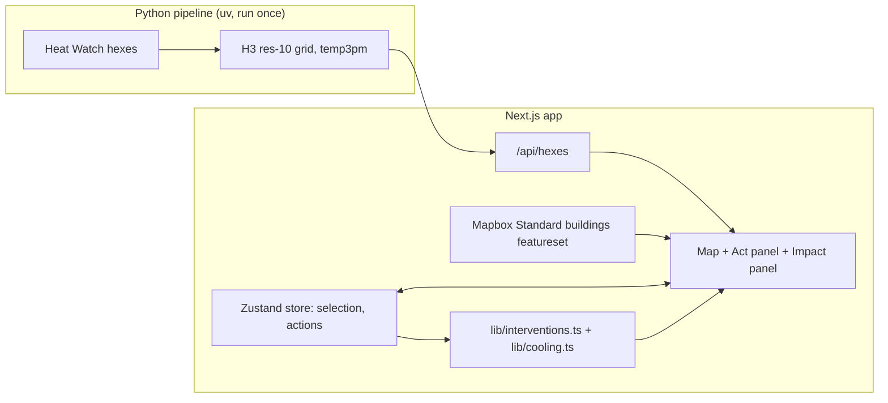

# Implementation Plan: CoolBoston

## Problem Statement
Boston planners and advocates want to see where urban heat is concentrated and what a specific fix would do. CoolBoston is a 3D map of Boston's afternoon heat where the user **selects a building or an area, applies a cooling action, and sees the surrounding heat map cool**. Solo hackathon build; execution plan and tasks are in `tasks/plan.md` and `tasks/todo.md`.

## Requirements
- 3D Mapbox map of Boston with 3D buildings and a heat layer (2019 Heat Watch, 3pm air temperature).
- Select a single building by clicking it, or an area as a set of hexes (click, shift-click, shift-drag box).
- Actions per selection:
  - Building: green roof, cool roof, rooftop solar.
  - Area: street trees, cool pavement, depave (impervious surface to green space). Each treats a fixed share of the area, set in the catalog.
- Applying an action lowers the temperature of the hex it sits in and, with falloff, its neighbours. The heat map recolors; a Change view shows the reduction on its own scale.
- A list of applied actions with remove, undo and reset, plus impact numbers (before, after, ΔT, area cooled, solar energy).
- Every cooling number is cited and labelled an estimate.
- Stack: Next.js (App Router, TypeScript), Mapbox GL JS v3 (Standard style), deck.gl (interleaved), Tailwind + shadcn/ui, Zustand. Python preprocessing runs offline; a Next.js route handler serves the result.

## Background (research findings)

### Heat data
- Heat Watch / Wicked Hot Boston 2019 hexes, "Canopy Change Assessment: Heat Metrics" (ArcGIS FeatureServer, layer 2). The app uses the 3pm mean air temperature (`Mean_p2_T_`, °F). Raw data on OSF (osf.io/49rjw).

### Possible context data (stretch)
- Canopy Change Assessment 2014–2019 hex bins (canopy, impervious and building area), for a suitability hint.

### Cooling effect references
- EPA Heat Island Compendium (green roof surfaces up to 56°F cooler than conventional roofs; air temperature reductions of up to 20°F cited for green roofs).
- Smith et al. 2025 (BU), "Integrated tree canopy expansion and cool roofs can optimize air temperature and heat exposure reductions in Boston". Tree canopy expansion has a 35% larger air temperature effect than cool roofs.
- Coefficients per action (with low/central/high ranges and sources) are researched in Task 14 and live only in `web/lib/interventions.ts`. The UI labels every estimate as approximate.

### Mapbox notes and risks
- Free tier is 50k map loads per month. A load counts when a Map object is created, so remounts count. The map is mounted once (verified: one style request per page load).
- The access token ships in the browser. Only `pk.` tokens are accepted; restrict it by URL in the Mapbox account settings.
- Mapbox GL JS v2+ is proprietary. The attribution must stay visible.
- Basemap is Mapbox Standard (`theme: "default"`, `lightPreset: "day"`, cream land, navy water, near-white buildings; see planui.md). Camera zoom must stay at or above 15, because Standard draws its 3D buildings only from there. 3D facades are off (their tiles 404 for downtown Boston).
- Building selection uses Standard's `buildings` featureset (`map.addInteraction`, feature state `select`, config `colorBuildingSelect`). Standard's 3D buildings take one color only; treated roofs are drawn as our own deck.gl caps. Task 16 confirms footprints and heights are usable; fallback is a downtown footprint GeoJSON from Analyze Boston.
- deck.gl runs interleaved. Heat hexes are a translucent 18 m slab in Standard's `middle` slot with normal depth testing: low-rise buildings show through tinted and towers rise above it. Flat (0 m) layers in that slot need a small negative `depthBias`, or they fail the depth test against Standard's ground.
- deck.gl gamma-corrects the layer `opacity` prop (0.5 composites as ~0.73). Put the requested opacity in the fill-color alpha instead.
- The map must be client-only (`dynamic(..., { ssr: false })`).
- Conference wifi risk: record a backup demo video.

## Proposed Solution



### Architecture decisions
- **Backend:** no separate server. The offline pipeline writes `web/data/hexes.json`; `/api/hexes` serves it statically. Deployable to Vercel.
- **Grid:** H3 resolution 10 (76 m edges, about 0.015 km² cells, 8,044 cells covering Boston). Heat Watch hexes are joined area-weighted.
- **Selection:** a building (from the Standard featureset: footprint, height, roof area, centroid cell) or a set of H3 cells.
- **Cooling model (browser, pure function):** `applyActions(hexes, actions)` → adjusted temperature and ΔT per cell. Source ΔT in a cell = coefficient × treated area / hex area; the effect spreads to H3 rings with a 0.5 falloff per ring up to the action's reach; effects add; the total per cell is capped (cap cited). No actions → identical to the baseline.
- **Color domain:** fixed to the baseline min/max so cooling shows as a shift toward blue; the Change view colors ΔT on its own scale.
- **Security:** read-only public data, no authentication, no user data stored server-side.

### Repo layout
```
hackachusetts/
  PLAN.md
  tasks/      # plan.md, todo.md
  web/        # Next.js app (TypeScript, Tailwind, shadcn/ui, Zustand, deck.gl, react-map-gl)
  pipeline/   # Python (uv, geopandas, h3, shapely, pytest)
  .env.example  # NEXT_PUBLIC_MAPBOX_TOKEN
```

## Dropped (pivot, Sat 12:33)
The original plan had a Landsat 2013–2025 yearly surface-temperature timeline with playback, time-series charts, per-hex intervention scores (percentile-weighted formulas), per-building score coloring, and an "adopt on the top N% of sites" simulator. All of it was dropped in favour of direct select-and-act interaction, which is a clearer demo and needs no multi-year raster processing. The 6am/7pm Heat Watch values were dropped with it (the app is 3pm only).

## Open questions
- Exact cooling coefficients and the per-cell cap (Task 14).
- Does Standard's featureset return whole, untiled footprints with heights (Task 16)?
