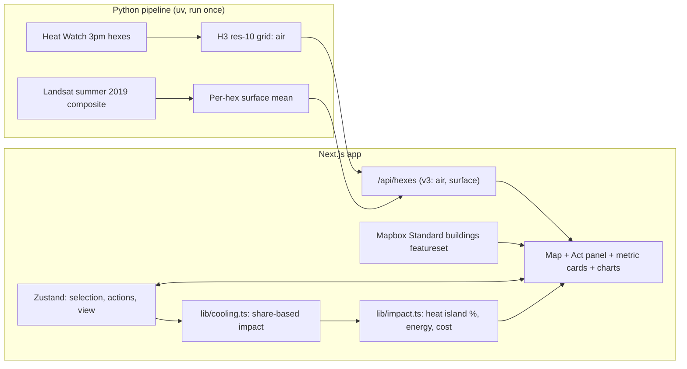

# Implementation Plan: CoolBoston

## Problem Statement
Boston planners and advocates want to see where urban heat is concentrated and what a specific fix would do. CoolBoston is a 3D map of Boston's heat where the user selects a building or an area, applies a cooling action, and sees the change in air temperature, surface temperature and heat-island percentage, plus an estimated energy offset and capital cost. Solo hackathon build. Execution plan and tasks: `tasks/plan.md` and `tasks/todo.md`.

## Requirements
- A 3D Mapbox map of Boston with 3D buildings and a heat layer. Air is the 2019 Heat Watch 3pm temperature. Surface is a summer 2019 Landsat composite, labelled mid-morning.
- Select a single building by clicking it, or an area as a set of H3 hexes (click, shift-click, shift-drag box).
- Actions:
  - Building: solar (energy only), green roof, cool building (roof albedo; wall materials not quantified), green walls, and green roof + solar as one roof action.
  - Area: street trees, adding 10 points of canopy across the selected area.
- Applying an action changes its hex only. The heat map recolours; Change mode shows the % reduction on its own scale.
- Metric cards for current conditions (air, surface, heat island in °F above the citywide mean) and for each change (air, surface, heat-island % change, energy offset, capital cost, roof surface change).
- A cost-versus-effect chart and a before-and-after chart in the bottom panel.
- Every number is labelled as an estimate. Values with no source read "not quantified".
- Stack: Next.js (App Router, TypeScript), Mapbox GL JS v3 (Standard style), deck.gl (interleaved), Recharts, Tailwind and shadcn/ui, Zustand. Offline Python preprocessing; one Next.js route handler serves the data.
- Session-only state: nothing is stored on a server.

## Background (research findings)

### Heat data
- **Air:** Heat Watch / Wicked Hot Boston, July 2019, 3pm mean (ArcGIS FeatureServer, layer 2, field `Mean_p2_T_`, °F).
- **Surface:** Landsat Collection 2 Level-2 thermal band, summer 2019 composite. Landsat 8 and 9 cross the equator at about 10:12 a.m. local solar time (USGS, NASA), so surface values are mid-morning, not 3pm.

### Cooling effect references
- **Smith et al. 2025**, *Communications Earth & Environment* 6:507. Afternoon air temperature: −0.61 °C per +0.1 surface albedo; −0.07 °C per +0.1 tree canopy fraction. Regional statistical model for southern New England, 2021–2022.
- **EPA Heat Island Compendium.** Green roof surfaces up to 56 °F cooler than conventional roofs (peak). Cool roofs 50–60 °F cooler at peak. Green roof city-wide air up to 5 °F (2019 snapshot). A newer EPA page says "up to 20 °F nearby", which is not used.
- **Energy:** ORNL simulation of a one-storey Boston building: green roof about 12% of heating plus cooling. Solar yield for Massachusetts about 1,320–1,425 kWh per kW per year (state average).
- **Costs:** vendor and consumer sources for green roofs, cool coatings, solar and green walls. See the inputs table in `tasks/plan.md`.

### Mapbox notes and risks
- Free tier is 50k map loads per month. A load counts when a Map object is created, so the map stays mounted once.
- The access token ships in the browser. Only `pk.` tokens are accepted. Restrict by URL in the Mapbox account.
- Mapbox GL JS v2+ is proprietary; attribution stays visible.
- Basemap is Mapbox Standard (default theme, navy water, near-white buildings; see `planui.md`). Camera zoom stays at or above 15, because Standard draws 3D buildings only from there. 3D facades are off (their tiles 404 for downtown Boston).
- Building selection uses Standard's `buildings` featureset. Its footprints and heights are unverified (Task 21). Treated roofs are drawn as our own deck.gl caps.
- Heat hexes are a translucent 18 m slab in Standard's `middle` slot with normal depth testing. Flat layers in that slot need a small negative `depthBias`.
- deck.gl gamma-corrects the layer `opacity` prop. Put the requested opacity in the fill-colour alpha instead.
- The map is client-only (`dynamic(..., { ssr: false })`).
- Venue wifi risk: record a backup demo video.

## Proposed Solution



### Architecture decisions
- **No backend.** Offline Python writes `web/data/hexes.json`; `/api/hexes` serves it. The impact model runs in the browser as pure functions.
- **Share-based impact model.** Each action's treated share of its hex, `s = treated area ÷ hex area`, capped at 1. Effects stay in the treated hex. Several actions in one hex add. No spread to neighbours. No extra cap.
- **Coefficients live in one module** (`web/lib/interventions.ts`). Every value has a source and a scale. Assumptions are labelled.
- **Heat-island metric:** `H = T − citywide mean` (fixed baseline over valid hexes). Change is `(H_before − H_after) ÷ H_before × 100`, n/a when `H_before ≤ 0.5 °F`.
- **Colour domains are fixed to the baseline.** Cooling shows as a shift toward blue in Air mode, and as its own scale in Change mode.
- **Roof rule:** one roof action per building. Green roof + solar is the only combination and counts as one action. Green walls can accompany any roof action.
- **Security:** read-only public data; no authentication; no server-side user state. A share link, if built, is validated and never evaluated.

### Repo layout
```
hackachusetts/
  PLAN.md
  tasks/      # plan.md, todo.md
  web/        # Next.js app (TypeScript, Tailwind, shadcn/ui, Zustand, deck.gl, react-map-gl, Recharts)
  pipeline/   # Python (uv, geopandas, h3, shapely, pytest)
  .env.example  # NEXT_PUBLIC_MAPBOX_TOKEN
```

## Dropped (pivot, Sat 12:33; scope agreed Sat 13:31)
The earlier plan had a Landsat yearly timeline with playback, time-series charts, per-hex intervention scores, per-building score colouring, a what-if simulator that adopted interventions on the top N% of sites, and context layers (canopy, Social Vulnerability Index, parking). These are gone. So are the suitability hint, free-form drawing, cool pavement and depave, and the 6am and 7pm Heat Watch values. A single 2019 surface composite is kept for the surface metric.

## Open Questions
- Remaining inputs: energy per m², tree cost per m², commercial solar cost, usable roof share, panel kW per m², commercial electricity rate, Boston PV yield (Task 14).
- Whether Mapbox's buildings featureset returns footprints and heights (Task 21).
- Landsat 8 thermal asset key (Task 15).
- Whether mid-morning surface values, clearly labelled, are acceptable in the metrics. Recommended: yes.
