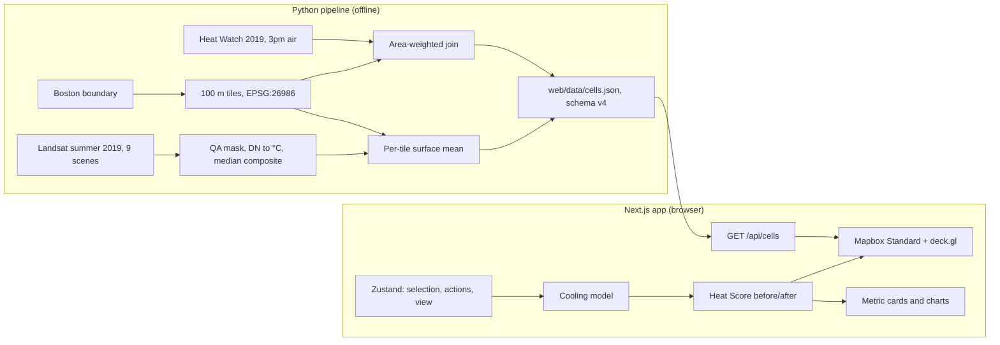

# CoolBoston

**See where Boston's urban heat is, and estimate what a cooling fix would do.**

CoolBoston is a 3D map of Boston's summer heat. Select a building or an area, apply a cooling action (green roof, cool roof, urban trees and more), and see an estimated before and after: a Heat Score, air and surface temperature, energy offset and capital cost. Every number is sourced and labelled as an estimate.

[](https://github.com/lvcasmadeit/hackachusetts/actions/workflows/ci.yml)


Built solo for Hackachusetts 2026.

---

## Contents

- [Why](#why)
- [Features](#features)
- [How it works](#how-it-works)
- [Getting started](#getting-started)
- [Rebuilding the data](#rebuilding-the-data)
- [Testing](#testing)
- [Project structure](#project-structure)
- [The model](#the-model)
- [Data sources](#data-sources)
- [Limitations](#limitations)
- [Roadmap](#roadmap)

## Why

Roofs, roads and parking lots absorb and give off much more heat than trees, grass or water. Where they are packed together, a city forms **urban heat islands**. In the U.S. these run about 1–7 °F hotter by day and 2–5 °F hotter at night than outlying areas ([EPA](https://www.epa.gov/heatislands/learn-about-heat-islands)). Heat islands raise the risk of heat illness, increase air-conditioning demand and emissions, and fall hardest on neighbourhoods with the least tree canopy.

In Boston in 2019, 3pm air temperature ranged from **87.8 °F to 94.5 °F** across the city. Summer surface temperature ranged from **46 °F to 131 °F**. Proven fixes exist, but the data and evidence are scattered. CoolBoston puts them in one place, so a planner or advocate can ask *"what if we cooled this building or this block?"* and get a sourced estimate.

## Features

- **3D heat map.** About 13,500 tiles of 100 m, clipped to Boston's land, under Mapbox 3D buildings.
- **Heat Score (0–100).** One relative CoolBoston index per tile. It combines 3pm air and mid-morning surface temperature. Categories: Low, Moderate, High, Very High. Hovering a tile shows its score.
- **Select.** Click a building, or select an area of tiles (click, shift-click, or shift-drag a box).
- **Act.**
  - Building actions: green roof, cool roof, solar panels, green walls, green roof + solar.
  - Area action: urban trees.
  - One roof action per building. Actions can be undone, removed or reset. Treated roofs are marked on the map.
- **Impact.**
  - Change mode recolours the map by score points reduced.
  - Metric cards show the score before and after, Δ air and Δ surface (°F), energy offset, capital cost (low, central and high) and area statistics.
- **Charts.** Cost against effect for each action, and before/after bars for the selection.
- **Method and About pages.** The formula, assumptions and sources, written in plain language.
- **No backend.** No accounts and no server-side state. The model runs in the browser.

## How it works



The only interface between the two halves is `web/data/cells.json`, and both sides validate it. The pipeline writes JSON with `allow_nan=False`. The web rejects missing or unknown keys, the wrong schema version and non-finite numbers (`parseCells` in `web/lib/data.ts`).

## Getting started

### Prerequisites

- Node.js 24 and npm
- A **public** Mapbox token (`pk.…`). [Create one](https://account.mapbox.com/access-tokens/) and restrict it to your URLs.
- Optional, only to rebuild the data: Python 3.12 and [uv](https://docs.astral.sh/uv/)

### Run the app

```bash
git clone https://github.com/lvcasmadeit/hackachusetts.git
cd hackachusetts/web
npm ci
cp ../.env.example .env.local    # then set NEXT_PUBLIC_MAPBOX_TOKEN=pk.…
npm run dev
```

Open <http://localhost:3000>. The map is at `/map`, and the explainer is at `/about`.

The processed data (`web/data/cells.json`) is committed, so the app runs without the pipeline.

> Only `pk.` tokens are accepted, because the token ships to the browser. Never put an `sk.` secret in a `NEXT_PUBLIC_` variable.

## Rebuilding the data

Run from `pipeline/`. The first run downloads the boundary, Heat Watch and Landsat scenes, which needs network access. Later runs reuse the cache in `pipeline/cache/` and `pipeline/data/raw/`. Both are gitignored.

```bash
cd pipeline
uv sync
uv run python -m coolboston.run_landsat   # Landsat composite -> per-tile surface cache
uv run python -m coolboston.build_cells   # joins air + surface -> web/data/cells.json
```

After the data changes, check the Heat Score calibration anchors:

```bash
cd web && npm run calibrate
```

## Testing

| Command (from repo root) | What it runs |
|---|---|
| `make check` | Web typecheck, lint and Vitest unit tests, plus pipeline pytest |
| `make build` | Production `next build` |
| `make e2e` | Playwright browser tests (needs a Mapbox token and WebGL) |

- **Web:** 200+ Vitest unit tests cover the cooling model, Heat Score, validators, the intervention catalog and selection.
- **Pipeline:** the pytest tests run offline against fixtures. They cover the grid, the join, the DN conversion, the cloud mask, the composite and the zonal means.
- **CI:** GitHub Actions runs `make check`-equivalent jobs and the build on every push to `main` and on every PR.

## Project structure

```
.
├── pipeline/                 Offline Python preprocessing (uv)
│   ├── src/coolboston/
│   │   ├── grid.py           100 m tiles in State Plane, clipped to Boston land
│   │   ├── heatwatch.py      Heat Watch 3pm ingest (zeros → null)
│   │   ├── join.py           Area-weighted join onto tiles
│   │   ├── landsat.py        STAC search (Planetary Computer)
│   │   ├── lst.py            DN → °C, QA_PIXEL cloud mask
│   │   ├── composite.py      Per-pixel nan-median
│   │   ├── zonal.py          Per-tile surface mean
│   │   ├── run_landsat.py    Surface runner → cache
│   │   └── build_cells.py    Writes web/data/cells.json (schema v4)
│   └── tests/
├── web/                      Next.js app (App Router, TypeScript strict)
│   ├── app/                  Routes: / (landing), /map, /about, /api/cells
│   ├── components/           Map, panels, layers, charts (React)
│   ├── lib/                  Pure logic: cooling, heatScore, interventions, store, validators
│   ├── data/cells.json       Processed data (committed)
│   └── e2e/                  Playwright specs
├── .kiro/                    Steering docs, specs and agent skills
├── tasks/                    Plans and task lists
├── PLAN.md                   Product definition
└── Makefile
```

### Tech stack

| Area | Tools |
|---|---|
| Web | Next.js 16, React 19, TypeScript, Tailwind CSS 4, shadcn/ui |
| Map | Mapbox GL JS 3 (Standard style) via react-map-gl, deck.gl 9 (interleaved) |
| State and charts | Zustand, Recharts |
| Pipeline | Python 3.12, uv, geopandas, shapely, rasterio, pyproj |
| Testing | Vitest, Testing Library, Playwright, pytest, GitHub Actions |

## The model

> CoolBoston is a screening tool. Its outputs are **estimates** for comparing options, not engineering predictions.

### Heat Score

The score is configured in `web/lib/heatScoreConfig.ts` and computed by `web/lib/heatScore.ts`:

```
A = clamp((T_air     − air_min)     / (air_max     − air_min),     0, 1)
S = clamp((T_surface − surface_min) / (surface_max − surface_min), 0, 1)
Heat Score = 100 × (0.6 × A + 0.4 × S)
```

- **Anchors:** Boston's 2nd–98th percentile for each input in 2019, so the score is *relative to Boston, summer 2019*. A test fails if the anchors drift from the data.
- **Weights:** preliminary design parameters, not validated coefficients.
- **Missing data:** a tile missing either input has no score. It shows as "No data", never as 0.
- **Not official:** this is a custom index, not an official or validated heat-health index.

### Cooling

The cooling model lives in `web/lib/cooling.ts`. Each action treats a share of each tile, and the temperature change is the coefficient × share.

- **Buildings, surface:** the effect stays on the tiles the footprint covers, with share = overlap ÷ tile land area.
- **Buildings, air:** the effect spreads over the surrounding 5 × 5 tiles (about 25 ha, the Heat Watch resolution).
- **Areas:** each selected tile is fully treated.
- **Spillover:** neighbouring tiles cool by ½ (one ring away) and ¼ (two rings away). The strongest effect wins, and effects do not stack.
- **Score change:** the Heat Score is recomputed from the new temperatures. No action changes the score directly.

### Sources for every number

The coefficients, costs and energy figures live in `web/lib/interventions.ts`. Each value has a citation and a stated scale. Assumptions are labelled, such as a +0.3 roof albedo change for cool roofs. Anything without a source reads "not quantified".

## Data sources

| Data | Source |
|---|---|
| Air temperature | 2019 Heat Watch / Wicked Hot Boston, 3pm mean (CAPA Strategies, Museum of Science) |
| Surface temperature | Landsat Collection 2 Level-2, June–August 2019, via [Microsoft Planetary Computer](https://planetarycomputer.microsoft.com/dataset/landsat-c2-l2) |
| Boundary | City of Boston GIS |
| Cooling effects | Smith et al. 2025, *Communications Earth & Environment* 6:507; [EPA Heat Island Compendium](https://www.epa.gov/heatislands/heat-island-compendium) |
| Costs and energy | NREL, EIA, LBNL, EPA and vendor sources (cited in `web/lib/interventions.ts`) |
| Basemap and buildings | Mapbox Standard |

## Limitations

- **Air resolution:** air data is only as fine as Heat Watch (about 25 ha). The 100 m tiles add surface detail, not air detail.
- **Timing:** the inputs are **not simultaneous**. Air is a 3pm July traverse. Surface is a mid-morning (about 11:15 a.m. EDT) summer median. Surface values are labelled "mid-morning" everywhere.
- **One year:** the data is a single summer, 2019.
- **Simple model:** the share-and-spillover cooling model is a modelling assumption, not a validated simulation.
- **Buildings:** footprints and heights come from Mapbox and may be incomplete. Some landmark towers highlight but do not change colour.

## Roadmap

- [ ] Deploy to Vercel
- [ ] Shareable scenario links
- [ ] Our own building tileset, for colouring buildings by data
- [ ] More Heat Watch campaigns and Landsat years

## Acknowledgements

Thanks to CAPA Strategies and the Museum of Science for the Heat Watch data, to USGS/NASA for Landsat, to Microsoft Planetary Computer for STAC access, and to the City of Boston for open GIS data. Built with [Kiro](https://kiro.dev).
